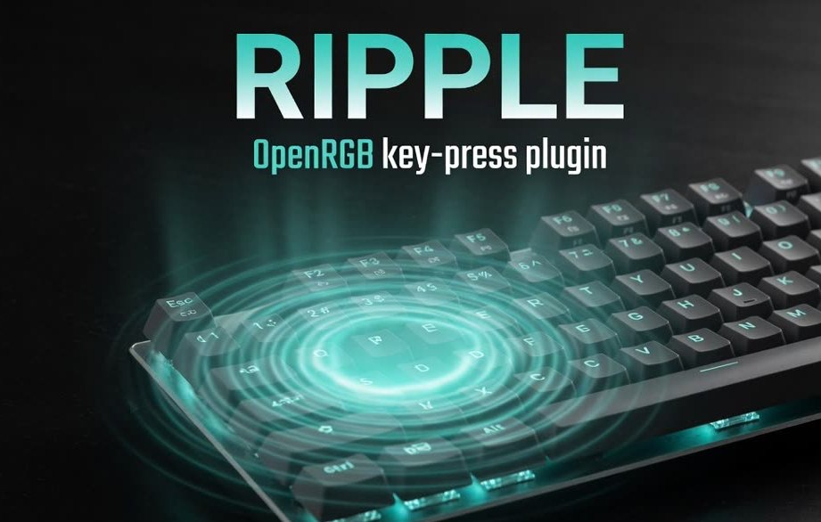
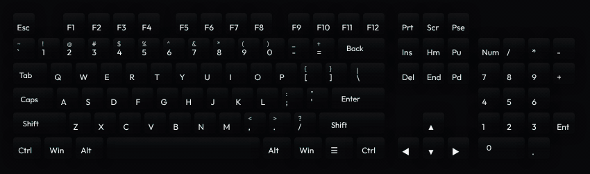
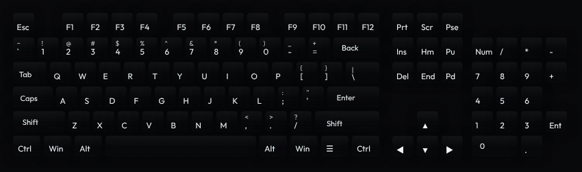
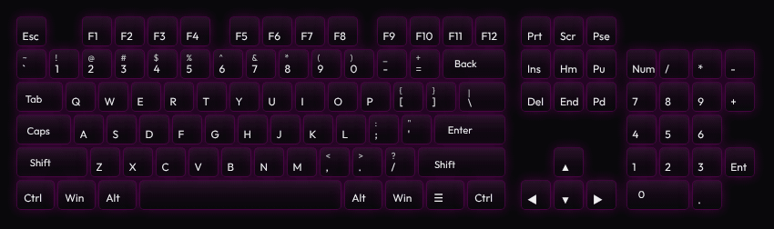
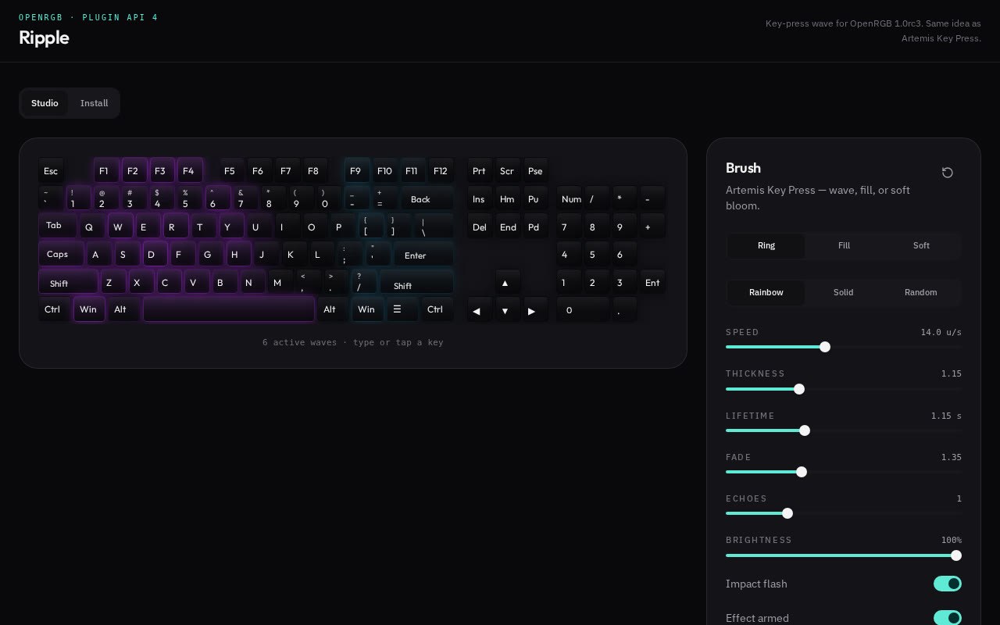

<div align="center">

<picture>
  <source media="(prefers-color-scheme: dark)" srcset="docs/logo-dark.png">
  <source media="(prefers-color-scheme: light)" srcset="docs/logo-light.png">
  
</picture>

### Artemis-style key-press ripples for [OpenRGB](https://openrgb.org)

[](https://github.com/camAtGitHub/openRGB-ripple-plugin/releases/latest)
[](https://github.com/camAtGitHub/openRGB-ripple-plugin/releases)
[](LICENSE)


[](https://github.com/camAtGitHub/openRGB-ripple-plugin/stargazers)

<br>



<br>

**[⬇️ Download](https://github.com/camAtGitHub/openRGB-ripple-plugin/releases/latest/download/OpenRGBRipplePlugin.dll)** &nbsp;·&nbsp;
**[🎮 Live demo](https://camatgithub.github.io/openRGB-ripple-plugin/)** &nbsp;·&nbsp;
**[📦 Install](#-installation)** &nbsp;·&nbsp;
**[💤 Idle timeouts](#-idle-timeouts)** &nbsp;·&nbsp;
**[🛠️ Build](#️-building-from-source)**

</div>

---

## ✨ Features

<table>
<tr>
<td width="50%" valign="top">

**🌊 Ripple styles**
Ring, fill, or soft waves rippling out from every key you press.

**🎨 Colour modes**
Rainbow, solid, or random.

**🔷 Shapes**
Circle, square, row/column, sweep, and dart.

</td>
<td width="50%" valign="top">

**💤 Idle timeout**
Hands off to the Effects plugin as a keyboard screensaver, then snaps back to Ripple when you type.

**🔌 Auto power-off**
Lights out after a period of inactivity.

</td>
</tr>
<tr>
<td colspan="2" align="center">

**📦 Single DLL** — drops straight into OpenRGB's tabbed menu. No installer, no dependencies.

</td>
</tr>
</table>

## 🔷 Shapes

<div align="center">

**Circle**<br>


<br><br>

**Sweep**<br>


<br><br>

**Dart**<br>


</div>

## 📦 Installation

> [!IMPORTANT]
> Requires **OpenRGB release 1.1** (Plugin API v5). OpenRGB 1.0 and the 1.0 release candidates use Plugin API v4 and won't load this DLL — grab an [older release](https://github.com/camAtGitHub/openRGB-ripple-plugin/releases) for v4.

1. Download **[`OpenRGBRipplePlugin.dll`](https://github.com/camAtGitHub/openRGB-ripple-plugin/releases/latest/download/OpenRGBRipplePlugin.dll)**
2. Copy it to `%APPDATA%\OpenRGB\plugins`
3. Restart OpenRGB and open the **Ripple** tab

> [!NOTE]
> The plugin installs a Windows keyboard hook, which may trigger an antivirus false positive. Microsoft Defender currently has no issues with it.

| OpenRGB version | Plugin API | Supported |
|---|:---:|:---:|
| 1.1 | v5 | ✅ Latest release |
| 1.0 / 1.0 RCs | v4 | ⚠️ Older releases only |

## 🎮 Web preview

Try it in your browser before installing — **[open the live preview](https://camatgithub.github.io/openRGB-ripple-plugin/)**.

<p align="center">
  <a href="https://camatgithub.github.io/openRGB-ripple-plugin/">
    
  </a>
</p>

## 💤 Idle timeouts

With the [Effects plugin](https://openrgb.org/plugin_effects.html) installed, the **Ripple** tab gains an **Idle Timeout (enable effects)** option. After a period of inactivity it switches to the Effects plugin, then hands back to Ripple as soon as you start typing.

<details>
<summary><b>Setup</b></summary>
<br>

1. In the **Effects** tab, pick the effect you want while idle (shaders work great) and set it to **stopped**.
2. In the **Ripple** tab, set the idle timeout duration.
3. Save your profile with **both** Effects and Ripple states included.

</details>

## 🛠️ Building from source

> [!TIP]
> You don't need to build anything to use the plugin — see [Installation](#-installation).

<details>
<summary><b>Build instructions</b></summary>
<br>

**Requirements:** Visual Studio 2022 (**Desktop development with C++**) and Python 3 on first run (to fetch Qt 6.8.3).

```powershell
cd OpenRGBRipplePlugin
powershell -ExecutionPolicy Bypass -File .\build-plugin.ps1
```

This builds `OpenRGBRipplePlugin.dll` and copies it to `%APPDATA%\OpenRGB\plugins`. Pass `-NoInstall` to skip the copy (CI / just produce the DLL).

Full details and the config table: [`OpenRGBRipplePlugin/README.md`](OpenRGBRipplePlugin/README.md)

</details>

## 🙏 Inspired by

The effect is inspired by the Ripple brush in [Artemis 2](https://github.com/Artemis-RGB/Artemis).

## 📄 License

[GPL-2.0-or-later](LICENSE), same as OpenRGB.

---

<div align="center">

If Ripple makes your keyboard happier, consider leaving a ⭐

<a href="https://star-history.com/#camAtGitHub/openRGB-ripple-plugin&Date">
  <picture>
    <source media="(prefers-color-scheme: dark)" srcset="https://api.star-history.com/svg?repos=camAtGitHub/openRGB-ripple-plugin&type=Date&theme=dark">
    
  </picture>
</a>

</div>
